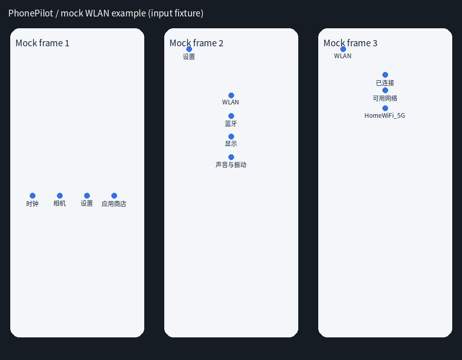

# PhonePilot

实验性 Android 手机 agent 框架。用一句自然语言描述任务，框架在手机上**感知 → 决策 → 执行**地把它做完，高风险动作默认停下来等你确认。

灵感来自抢票脚本 `bw_ticket_bot`：本地感知 + 本地状态机跑高频决策，LLM 只在「起始规划 / 卡住 / OCR 看不懂」时介入，绝不参与每帧决策。

## Automatic rendering / 自动渲染

[](https://github.com/Kevin0412/PhonePilot/actions/workflows/render-gallery.yml)



Runs the existing mock WLAN example without credentials or a phone. The preview is a diagram of the mock input elements, accompanied by the actual CLI execution log in artifacts; not a real Android screenshot.

[Download workflow artifacts](https://github.com/Kevin0412/PhonePilot/actions).

## 设计要点

```
感知(本地)                     决策(本地优先, 逐级升级)                  执行(可插拔)
screencap ─► OCR + 图标 ─► 页面签名 ─► 本地规则 ─► 安全校验 ─► RiskGate ─► Executor
   │  └ 元素带坐标            │(卡住)                       (高风险/坐标点击确认) tap/swipe/
   │                         ├► 快速文本LLM(仅文字, 关思考) ◄ 求效率           long_press
   │                         ├► 结构化LLM(元素+坐标+图标, 可思考) ◄ 难例        /text/key
   └ OCR空/看不懂 ───────────┴► 视觉LLM(看截图给坐标) ◄ 仅前两级不够
```

- **执行层可插拔**：开发期 `adb`（PC 驱动真机），生产期换成原生 App 里的 Shizuku（同一组 shell 命令串）。测试用 `mock`。
- **本地优先**：每帧本地 OCR + 规则状态机做高频决策；卡住才异步升级 LLM（单槽、忙时丢弃、结果带新鲜度）。
- **手势一等公民**：tap / long_press / swipe / scroll / fling / back / home。
- **三层 LLM**：快速文本（关思考，求效率）→ 结构化（带坐标+图标，可思考）→ 视觉兜底（Qwen-VL/GLM-4V/Kimi/MiMo）。
- **安全**：动作前校验（越界/错位/黑名单）；高风险与无法交叉校验的坐标点击默认人工确认；命中支付/验证码等标志硬停交人工。

## 安装

```bash
python -m venv .venv && source .venv/bin/activate
pip install -e .            # 核心（mock 跑通逻辑用）
pip install -e ".[device]"  # 接真机做 OCR 时再装 opencv + rapidocr
pip install -e ".[dev]"     # 跑测试
```

## 快速开始（无真机，纯逻辑跑通）

```bash
phonepilot run --example examples/open_wlan.yaml
```

真连 LLM 验证规划（无需真机，把一句话变成结构化 Plan 并打印）：

```bash
phonepilot plan --task "打开微信给文件传输助手发：今晚加班" --llm openai      # MiMo (mimo-v2.5)
phonepilot plan --task "卸载抖音这个App"                      --llm deepseek    # deepseek-v4-flash（高风险步骤会标 high）
# 用 DeepSeek 的 Anthropic 兼容端点联调 Claude 代码路径：
phonepilot plan --task "打开设置进入WLAN" --llm claude \
  --llm-base-url https://api.deepseek.com/anthropic --llm-model deepseek-v4-flash --llm-env-key DEEPSEEK_API_KEY
```

LLM 三类可插拔：`deepseek`（原生）、`claude`（Anthropic Messages，可指向兼容端点）、`openai`（通用 OpenAI 兼容，`--llm-provider mimo|qwen|kimi|glm`）。密钥放 `.env`。

接真机（USB 或 wifi-ADB 连好、`adb devices` 能看到）：

```bash
phonepilot inspect --executor adb        # 只截图+OCR+图标+页面签名，不点不调 LLM
phonepilot run --executor adb --llm deepseek --task "..." --dry-run   # 决策全跑，执行空操作+审计落盘
phonepilot run --executor adb --llm deepseek --task "..."             # 真执行
```

低风险实机烟测（固定 mock plan + 系统 WLAN intent，不依赖真实 LLM）：

```bash
RUNS=3 scripts/adb_smoke.sh
```

复杂实机回归（不调真实 LLM，不写坐标；覆盖 package 启动、设置页点击、搜索输入、搜索结果消歧）：

```bash
scripts/adb_complex_suite.sh
```

注意：`--example` 会强制走 mock executor；实机 ADB 测试请用 `--plan-file examples/adb_wlan_intent.yaml` 或直接用上面的脚本。

密钥放 `.env`（见 `.env.example`），或导出为环境变量。

## 运行产物

每次 `run` 在 `runs/<时间戳>/` 落盘截图、OCR JSON、决策审计与停止快照，便于 `replay` 复盘与规则调试。

## 迁移到原生 App

可插拔接口已把「纯逻辑」与「平台运行时」切开。原生化时只需用 Android 后端重实现 `Executor`（Shizuku Binder）、`OcrEngine`（ML Kit / onnxruntime-android）、HTTP 客户端；状态机/签名/规则/安全/风险等纯逻辑可机械翻译，或用 Chaquopy 直接嵌入复用。详见 `phonepilot/` 各模块文档与项目计划。

## 状态

MVP 骨架。已实现：执行器全原语、手势映射、本地规则（含滚动翻找）、快速文本 LLM 路径、结构化感知、安全/风险闸门、端到端 Mock。接口+桩就位、可逐个试：结构化 LLM 路径、图标模板、视觉适配器。
